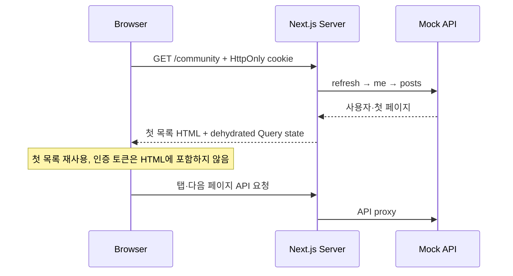

# Linkfit Frontend Showcase

Linkfit의 실제 프론트엔드 코드에서 추출한 설계 사례와 실행 예제입니다. 운영 서비스 전체를 공개하는 대신, 문제를 해결한 핵심 코드와 확인 방법을 함께 정리했습니다.

**SSR은 최근 추가한 기술 검증 사례입니다. 운영 환경의 성능 개선이나 장기간 사용 실적을 의미하지 않습니다.** 실제 회원 정보·운영 주소·인증 정보 없이 로컬 모의 API로 실행합니다.

## 처음 보신다면

| 관심 주제 | 먼저 읽을 코드 | 확인할 내용 |
| --- | --- | --- |
| 첫 목록 SSR과 인증 | [community/page.tsx](src/app/community/page.tsx) → [getServerSession](src/features/auth/api/getServerSession.ts) → [CommunityFeed](src/app/community/CommunityFeed.tsx) | 서버 조회 데이터를 브라우저 Query 캐시에 연결하는 방식 |
| 선언적 비동기 처리 | [AsyncBoundary](src/shared/ui/AsyncBoundary.tsx) → [사용 예제](src/app/async-boundary/page.tsx) | 로딩·오류·재시도 경계를 위젯 단위로 분리 |
| 시각화 모듈 분리 | [dynamic import](src/app/visualization/page.tsx) → [ExerciseHistoryChart](src/widgets/exercise/ui/ExerciseHistoryChart.tsx) | 화면과 Chart.js·브라우저 전용 줌 플러그인의 의존성 분리 |
| 운동 기록 보존 | [syncQueue](src/entities/session/model/syncQueue.ts) → [테스트](tests/sync-queue.test.ts) | 네트워크 실패 시 큐 보관·재시도·정리 정책 |
| WebView 상호작용 | [제스처 처리](src/widgets/plan/ui/ReorderableExerciseItem.tsx) → [브리지](src/shared/utils/webview-bridge.ts) | 드래그 후 클릭 억제와 웹·네이티브 메시지 경계 |

원본 파일과 공개용 변경 범위는 [코드 출처·변경 내역](docs/SOURCE_MAP.md)에 정리했습니다.

## 실행

Node.js 20.19 이상이 필요합니다. 운영용 `.env`나 실제 로그인이 필요하지 않습니다.

```bash
npm ci
npm run dev
```

[http://127.0.0.1:3000](http://127.0.0.1:3000)에서 시작합니다. `dev` 명령은 Next.js와 로컬 모의 백엔드를 함께 시작합니다. `Ctrl+C`로 함께 종료합니다. 포트 변경 예: `PORT=3100 npm run dev`.

| 경로 | 실행해 볼 내용 |
| --- | --- |
| `/login` → `/community` | 사용자 A·B 선택, 서버 첫 목록, 탭 전환, 다음 페이지 조회 |
| `/login`의 예외 시나리오 | 인증 만료, 프로필 미완성, 백엔드 장애 분기 |
| `/async-boundary` | 첫 요청 실패 → 다시 시도 → 위젯 복구 |
| `/visualization` | 차트 열기, 모듈 로딩, 운동 기록 차트·줌 동작 |

데모 로그인은 누구나 선택 가능한 **가상 사용자 전용 기능**입니다. 실제 서비스의 인증 구현으로 사용하지 않습니다. 모의 백엔드도 localhost에만 바인딩합니다.

## 1. 인증된 커뮤니티 첫 목록 SSR

**문제와 목적** — 클라이언트 인증 확인 후 목록을 조회하는 구조에서는 첫 HTML에 목록이 없습니다. 첫 목록을 서버에서 준비하면서 기존 Query 기반의 탭·페이지 조회를 유지하도록 구성했습니다.



- 요청마다 서버 QueryClient를 생성하고 `HydrationBoundary`로 첫 페이지를 전달합니다.
- 사용자 ID별 클라이언트 Provider를 분리하고, 서버 요청과 개인화 HTML을 공유 캐시에 저장하지 않습니다.
- 서버·클라이언트가 목록 키·페이지 크기·staleTime을 공유해 초기 중복 조회를 피합니다.
- 인증 실패와 백엔드 장애를 구분합니다. 장애를 곧바로 로그아웃으로 처리하지 않습니다.

**확인 방법** — 페이지 소스와 `npm run test:ssr`에서 첫 게시글 HTML, 사용자 A → B → A 데이터 격리, 토큰 비노출과 인증 분기를 확인합니다. 컴포넌트 테스트는 초기 중복 요청과 후속 페이지 조회를 확인합니다.

**범위와 한계** — 첫 목록만 SSR입니다. 공개 예제의 다음 페이지 버튼은 원본 무한 스크롤 트리거를 대체합니다. 원본의 Jotai·공통 내비게이션은 생략했습니다. SSR이 응답 시간을 항상 줄인다고 가정하지 않으며, 운영 성능 비교는 별도 과제입니다.

[상세 설명과 읽기 순서](docs/cases/COMMUNITY_SSR.md)

## 2. 로딩·오류·재시도를 분리한 AsyncBoundary

**문제와 목적** — 데이터 컴포넌트마다 로딩·실패 분기를 반복하지 않고, 실패 범위와 재시도 UI를 상위 경계에서 정하도록 구성했습니다.

- `Suspense`는 로딩 화면, `ErrorBoundary`는 렌더링 중 발생한 오류를 처리합니다.
- `QueryErrorResetBoundary`와 오류 경계의 reset을 연결해 실패한 쿼리를 다시 시도합니다.
- `resetKeys`가 바뀌면 다른 입력·대상에 대해 경계를 초기화할 수 있습니다.

**확인 방법** — `/async-boundary`에서 인접 위젯은 유지한 채 실패한 위젯을 복구합니다. [테스트](tests/async-boundary.test.tsx)는 정상 조회·실패 후 재시도·resetKeys 변경을 확인합니다.

**한계** — 이벤트 핸들러나 임의의 비동기 콜백 오류를 모두 잡는 장치가 아닙니다. 전체 Query 캐시를 지우는 구현도 아닙니다.

[상세 설명과 읽기 순서](docs/cases/ASYNC_BOUNDARY.md)

## 3. 시각화 모듈 분리와 클라이언트 로딩

**문제와 목적** — 조회 화면에서 Chart.js 등록과 줌 플러그인 설정을 분리하고, 브라우저 전용 의존성을 서버 렌더링과 구분했습니다.

- 원본 화면의 직접 파일 경로 import와 `next/dynamic` 설정을 가져왔습니다.
- 추출한 `ExerciseHistoryChart`는 기록 정렬, 볼륨·추정 1RM 표시와 줌·팬 설정을 담당합니다.
- 공개 예제의 표시 버튼과 가상 기록으로 차트 로딩을 확인할 수 있습니다.

**확인 방법** — `/visualization`에서 차트를 열고 Network의 JS 요청과 실제 차트 동작을 확인합니다.

**한계** — `ssr: false`만으로 차트가 항상 클릭 시점에 다운로드된다고 보장하지 않습니다. 청크 로딩과 선행 로딩 여부는 빌드 결과·브라우저 Network로 확인해야 합니다. 이 저장소에서 번들 감소율이나 LCP 개선율은 측정하지 않았습니다.

[상세 설명과 읽기 순서](docs/cases/VISUALIZATION.md)

## 기존 핵심 사례

기존 파일은 유지했습니다. 아래 항목은 독립 코드·테스트 중심이며, 브라우저 데모를 제공하는 범위와 구분합니다.

| 사례 | 소스 | 테스트·검토 포인트 |
| --- | --- | --- |
| 동시 401의 갱신 요청 조정 | [axios.ts](src/shared/api/axios.ts) | [테스트](tests/token-refresh.test.ts): 5개 동시 요청에서 갱신 1회. 갱신 실패 시 대기 Promise 정리 정책은 추가 검토 과제 |
| 좋아요 낙관적 업데이트 | [optimisticLike.ts](src/entities/community/api/optimisticLike.ts) | [테스트](tests/optimistic-update.test.ts): 상세·목록 스냅샷과 실패 복원. 서버 데이터의 무결성을 무조건 보장한다는 의미는 아님 |
| 웹·네이티브 브리지 | [webview-bridge.ts](src/shared/utils/webview-bridge.ts) | [테스트](tests/webview-bridge.test.ts): 메시지 전송·플랫폼 분기. 실제 iOS·Android 네이티브 구현은 포함하지 않음 |
| 오프라인 동기화 큐 | [syncQueue.ts](src/entities/session/model/syncQueue.ts) | [테스트](tests/sync-queue.test.ts): 성공 제거·실패 보관·재시도. 저장소 삭제나 모든 장애에서 데이터 유실을 방지한다는 의미는 아님 |
| 드래그 후 클릭 억제 | [ReorderableExerciseItem](src/widgets/plan/ui/ReorderableExerciseItem.tsx) | `wasDraggedRef`로 드래그 후 클릭 구분, 브리지로 제스처 시작·종료 전달. 네이티브 스크롤 제어는 앱 셸의 책임 |
| 다단계 화면 렌더링 | [useFunnel](src/shared/hooks/useFunnel.tsx) | [테스트](tests/use-funnel.test.tsx): 선택한 단계만 렌더링. 이 훅 자체에 뒤로가기 이력 스택은 없음 |

## 검증 명령

```bash
npm test
npm run type-check
npm run build
npm run test:ssr
```

프로덕션 실행은 빌드 후 `npm start`를 사용합니다. 통합 테스트는 로컬 모의 백엔드와 빌드된 Next.js 앱을 시작하고 종료하며, 기본 3175 포트는 `SSR_TEST_PORT`로 변경할 수 있습니다.

테스트 통과는 정해진 시나리오의 결과입니다. 운영 장애 0건·데이터 유실 0%·0ms 반응·무중단·60fps를 증명하지 않습니다. 성능을 소개할 때는 측정 환경과 전후 결과를 별도로 제시합니다.

## 디렉터리

```text
src/app/                  실행 가능한 공개 예제와 데모 전용 Route Handler
src/entities/             동기화 큐·커뮤니티 캐시·시각화 데이터 타입
src/features/auth/        서버 인증 흐름과 사용자별 Query Provider
src/shared/               API·비동기 경계·브리지·공통 훅
src/widgets/              실제 서비스에서 추출한 제스처·차트 컴포넌트
scripts/                  가상 사용자·로컬 모의 API·실행기
tests/                   단위·컴포넌트·프로덕션 HTTP 통합 테스트
docs/                    사례별 읽기 순서·원본 대비 변경 범위
```

디렉터리는 기존 서비스의 계층 구성을 참고합니다. 공개 예제의 데모 코드는 서비스 전체의 FSD 구조를 재현하려는 목적은 아닙니다.

## 작성자

김혁수 · Linkfit Frontend
