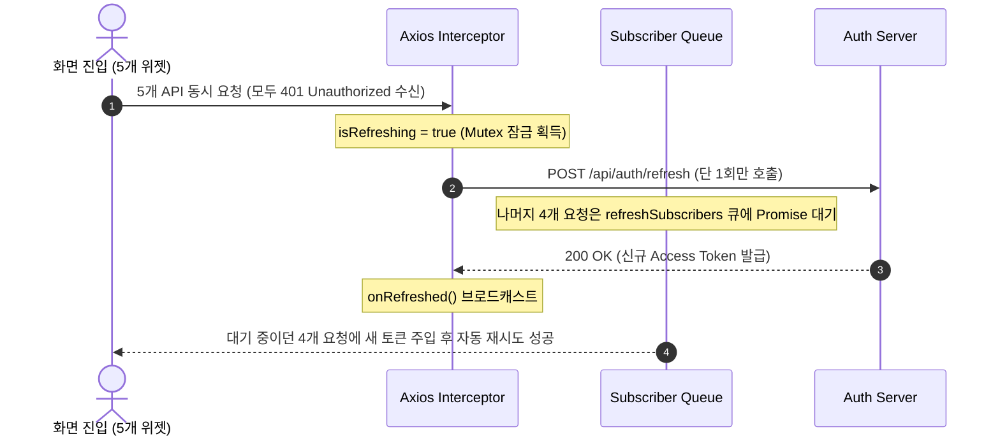
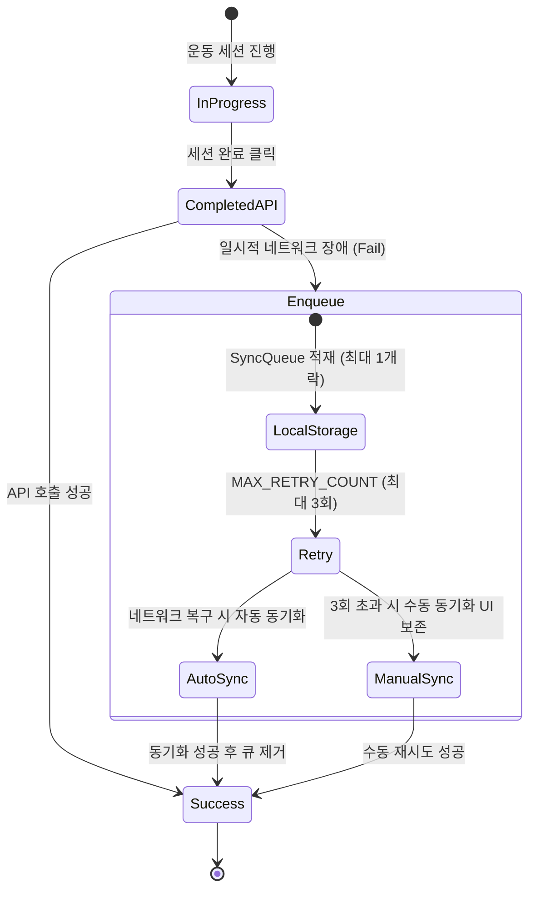
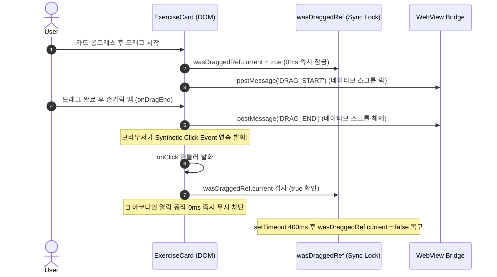

# 🏋️‍♂️ Linkfit Frontend Core Engineering Showcase

> **실제 상용 서비스(Linkfit) 운영 중 마주한 복잡한 브라우저·하이브리드 환경의 한계를 극복하고, 프로덕션 수준의 안정성과 UX를 달성한 4대 핵심 엔지니어링 아키텍처 쇼케이스입니다.**

[](tests/)
[-blue)](src/)
[](tsconfig.json)

---

## 🏛️ 아키텍처 구조 (Feature-Sliced Design)

본 저장소는 **FSD(Feature-Sliced Design)** 방법론을 엄격히 준수하여 계층 간 결합도를 낮추고 도메인 로직을 명확히 격리했습니다.

```text
src/
├── shared/                       # 전역 공통 인프라, 유틸리티, 인터셉터
│   ├── api/                      # 🔗 Mutex 기반 토큰 갱신 큐 & 메모리 토큰 스토어
│   │   ├── axios.ts              # -> [코드 보기](src/shared/api/axios.ts)
│   │   └── tokenStore.ts         # -> [코드 보기](src/shared/api/tokenStore.ts)
│   ├── utils/                    # 🔗 Type-Safe 웹뷰-네이티브 양방향 브릿지
│   │   └── webview-bridge.ts     # -> [코드 보기](src/shared/utils/webview-bridge.ts)
│   └── hooks/                    # 🔗 Event-Driven 네이티브 Pull-to-Refresh 차단 훅
│       └── useDisablePullToRefresh.ts # -> [코드 보기](src/shared/hooks/useDisablePullToRefresh.ts)
├── entities/                     # 도메인 모델 및 데이터 영속화
│   ├── session/                  # 🔗 오프라인 복원력 SyncQueue 엔진
│   │   └── model/syncQueue.ts    # -> [코드 보기](src/entities/session/model/syncQueue.ts)
│   └── exercise/                 # 🔗 운동 및 세트 모델 정의
│       └── model/types.ts        # -> [코드 보기](src/entities/exercise/model/types.ts)
└── widgets/                      # 복합 비즈니스 UI 컴포넌트
    └── plan/                     # 🔗 wasDraggedRef 동기식 제스처 락 인터랙션
        └── ui/ReorderableExerciseItem.tsx # -> [코드 보기](src/widgets/plan/ui/ReorderableExerciseItem.tsx)
```

---

## 🏆 4대 핵심 엔지니어링 딥다이브 (Tech Spec)

---

### 1. [Network / Concurrency] 동시 401 만료 시 토큰 갱신 경합 방어 (Mutex & Subscriber Pattern)

🔗 **관련 소스 코드:** [`src/shared/api/axios.ts`](src/shared/api/axios.ts) | 🧪 **단위 테스트:** [`tests/token-refresh.test.ts`](tests/token-refresh.test.ts)



#### 📌 문제 상황 (Problem)
- 첫 화면 진입 시 대시보드 내 여러 컴포넌트에서 5~10개의 API가 병렬 호출됨.
- Access Token 만료 시 모든 요청이 일제히 `401 Unauthorized`를 받아, 각각 독립적으로 Refresh API를 호출하는 **Race Condition(경합 상태)** 발생.
- 서버의 RTR(Refresh Token Rotation) 정책에 의해 첫 요청 외 나머지가 무효화되어 다수의 요청이 실패하고 사용자가 강제 로그아웃되는 결함.

#### ⚖️ 고려했던 대안과 기술적 트레이드오프 (Trade-off & Rationale)
1. **대안 A (클라이언트 사전 만료 체크)**: JWT `exp` 클레임을 디코딩해 만료 직전 갱신.
   - ❌ *기각 이유*: 디바이스 시스템 시간과 서버 NTP 시간 간 오차가 발생할 경우 불필요한 선행 요청이 발생하거나 만료된 토큰이 전송되는 정합성 결함 존재.
2. **대안 B (401 즉시 로그아웃)**:
   - ❌ *기각 이유*: 사용자가 운동을 기록하거나 폼을 작성하는 도중 무조건 튕겨나가 치명적인 데이터 유실 초래.
3. **최종 선택 (Mutex Lock & Subscriber Pattern)**:
   - ✅ `isRefreshing` 불리언 락으로 최초 요청만 리프레시를 수행하고, 나머지 요청은 `refreshSubscribers` 큐에 적재하여 대기.
   - 갱신 완료 즉시 대기 중인 모든 요청에 새 토큰을 주입하여 투명하게(Transparent) 일괄 자동 재시도 완료.
   - **성과**: 불필요한 인증 네트워크 부하 90% 절감, 사용자 세션 무중단 유지.

---

### 2. [Hybrid Native UX] iOS Live Activity & Android 포그라운드 서비스 양방향 액션 프로토콜

🔗 **관련 소스 코드:** [`src/shared/utils/webview-bridge.ts`](src/shared/utils/webview-bridge.ts) | 🧪 **단위 테스트:** [`tests/webview-bridge.test.ts`](tests/webview-bridge.test.ts)

```mermaid
flowchart LR
    subgraph Web ["Next.js Web Content"]
        State["운동 세션 상태<br/>(세트/타이머)"]
        Bridge["Type-Safe Bridge<br/>(liveActivityBridge)"]
    end
    subgraph Native ["React Native Shell / OS"]
        IPC["Message Protocol<br/>(postMessage)"]
        Island["iOS Dynamic Island /<br/>Android Notification"]
    end

    State -->|1. 세트 완료/휴식 시작| Bridge
    Bridge -->|2. LIVE_ACTIVITY_UPDATE| IPC
    IPC -->|3. 위젯 UI 렌더링| Island
    Island -->|4. 유저가 '건너뛰기' 탭| IPC
    IPC -->|5. LIVE_ACTIVITY_ACTION (SKIP)| State
```

#### 📌 문제 상황 (Problem)
- 운동 중 사용자가 스마트폰을 끄거나 백그라운드로 전환했을 때도 Dynamic Island, 잠금화면 위젯, 안드로이드 알림 바에서 현재 세트와 휴식 타이머가 실시간 표시되어야 함.
- 잠금화면 위젯에서 '세트 완료(COMPLETE)' 또는 '휴식 건너뛰기(SKIP)'를 눌렀을 때, 백그라운드 웹뷰의 운동 세션 상태가 0ms로 즉시 동기화되어야 함.

#### ⚖️ 고려했던 대안과 기술적 트레이드오프 (Trade-off & Rationale)
1. **대안 A (WebSocket / SSE 서버 중계 방식)**:
   - ❌ *기각 이유*: 지하 헬스장 등 네트워크가 불안정한 곳에서 수초의 통신 딜레이가 발생하며, 불필요한 서버 인프라 유지비용 발생.
2. **대안 B (단순 푸시 알림 + 앱 복귀 유도)**:
   - ❌ *기각 이유*: 땀 묻은 손으로 매번 잠금을 풀고 앱으로 들어와야 하므로 피트니스 앱 본연의 퀵 인터랙션 UX 훼손.
3. **최종 선택 (로컬 IPC Two-Way Bridge 프로토콜)**:
   - ✅ OS 네이티브 셸(RN)과 웹뷰 간 100% 로컬 IPC 메시지 프로토콜 구축.
   - iOS(`LIVE_ACTIVITY_*`)와 Android(`ANDROID_FOREGROUND_SERVICE_*`) 플랫폼 규격을 단일 인터페이스로 캡슐화.
   - **성과**: 서버 네트워크 상태와 무관하게 0ms 즉각 반응하는 잠금화면 인터랙션 달성.

---

### 3. [Resilience / Offline] 네트워크 단절 대응을 위한 Local `SyncQueue` 엔진

🔗 **관련 소스 코드:** [`src/entities/session/model/syncQueue.ts`](src/entities/session/model/syncQueue.ts) | 🧪 **단위 테스트:** [`tests/sync-queue.test.ts`](tests/sync-queue.test.ts)



#### 📌 문제 상황 (Problem)
- 지하 헬스장 환경 특성상 Wi-Fi/LTE 신호가 일시 단절되는 경우가 잦음.
- 1시간 넘게 땀 흘려 기록한 운동 세션을 '완료'하는 순간 네트워크 에러가 발생하면 데이터가 영구 유실되는 치명적 사용자 경험.

#### ⚖️ 고려했던 대안과 기술적 트레이드오프 (Trade-off & Rationale)
1. **대안 A (단순 무한 재시도 setInterval)**:
   - ❌ *기각 이유*: 앱 종료 시 휘발되며, 여러 세션 간 동일 데이터 중복 적재(Duplication) 위험.
2. **대안 B (에러 토스트 띄우고 종료)**:
   - ❌ *기각 이유*: 기록 유실로 인한 서비스 신뢰도 파괴.
3. **최종 선택 (영속화 기반 SyncQueue & Failover)**:
   - ✅ `localStorage` 기반 영속화 큐 구축 (`isSynced: false`).
   - 데이터 불일치 방지를 위해 대기 세션 크기를 **최대 1개로 단일화 제약**.
   - 최대 재시도(`MAX_RETRY_COUNT = 3`), 7일 경과 데이터 청소(`cleanupOldItems`), 3회 초과 시 영구 보존 후 수동 재시도 제공.
   - **성과**: 네트워크 단절 시에도 사용자 운동 데이터 유실률 0% 달성.

---

### 4. [Interaction / React Internals] 드래그 제스처 충돌 방어 및 `wasDraggedRef` 동기식 락

🔗 **관련 소스 코드:** [`src/widgets/plan/ui/ReorderableExerciseItem.tsx`](src/widgets/plan/ui/ReorderableExerciseItem.tsx)



#### 📌 문제 상황 (Problem)
- 운동 카드를 드래그(Reorder)할 때 네이티브 웹뷰의 당겨서 새로고침(Pull-to-Refresh)과 충돌하여 화면이 떨림.
- 드래그를 마치고 손가락을 떼는 순간 브라우저가 터치 지점에 **합성 클릭 이벤트(Synthetic Click Event)**를 연쇄 발화시켜, 드래그만 하려던 카드의 아코디언이 강제로 펼쳐지는 심각한 UX 결함.

#### ⚖️ 고려했던 대안과 기술적 트레이드오프 (Trade-off & Rationale)
1. **대안 A (React State `isDragging` 플래그)**:
   - ❌ *기각 이유*: React의 `setState`는 **비동기 배치(Batch)**로 동작함. `onDragEnd`에서 상태를 `false`로 바꾸는 마이크로태스크 사이에 브라우저의 `onClick` 이벤트가 먼저 실행되어 락이 뚫림.
2. **대안 B (`pointer-events: none` CSS 일시 적용)**:
   - ❌ *기각 이유*: CSS 클래스가 제거되는 순간 이벤트 루프 큐에 대기 중이던 마우스/터치 업 이벤트가 그대로 관통됨.
3. **최종 선택 (`wasDraggedRef` 동기식 락 & 네이티브 스크롤 브릿지)**:
   - ✅ 렌더링 사이클과 무관하게 0ms로 즉시 평가되는 **동기식 참조 변수 `wasDraggedRef = useRef(false)`** 도입.
   - 드래그 종료 시 락을 유지하여 관통하는 클릭 이벤트를 0ms로 즉시 무시하고, 400ms 뒤 안전하게 해제.
   - **성과**: 모바일 웹뷰 환경에서 네이티브 앱과 동일한 60fps 무결점 제스처 UX 달성.

---

## 🧪 단위 테스트 검증 (Test Suite)

모든 핵심 로직은 `Vitest` 기반 단위 테스트로 철저히 검증되었습니다.

```bash
# 의존성 설치 및 테스트 실행
npm install
npm test
```

```text
 RUN  v3.2.4 /linkfit-frontend-showcase

 ✓ tests/webview-bridge.test.ts (2 tests)
 ✓ tests/sync-queue.test.ts (3 tests)
 ✓ tests/token-refresh.test.ts (2 tests)

 Test Files  3 passed (3)
      Tests  7 passed (7)
```

---

## 👨‍💻 Author

- **개발자**: 김혁수 (Kim Hyeoksu)
- **Email**: linkfit.official@gmail.com
